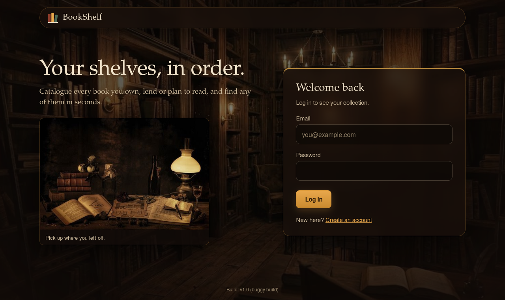
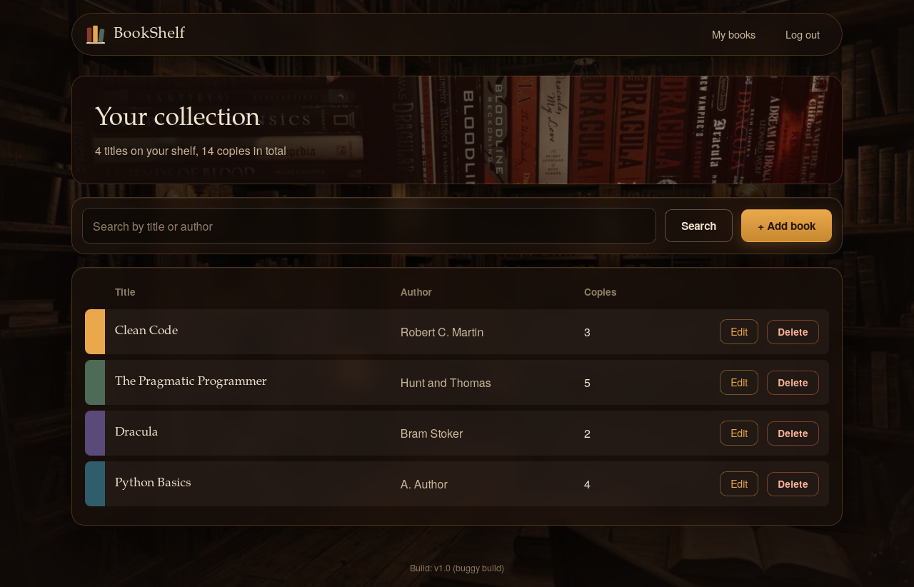

# BookShelf: Selenium Regression and Exploratory Testing Project


A small Flask web app (**BookShelf**) used as the application under test, plus a complete testing project around it: test plan, bug taxonomy, an automated **Selenium WebDriver** regression suite, a **Selenium IDE** project, a defect log with screenshots, and exploratory testing charters.

> **The bugs are deliberate.** The app ships in two builds of the same code: **v1.0 (`buggy`)** has 8 documented seeded defects, **v1.1 (`fixed`)** has them corrected. This is what lets the project demonstrate detection, defect logging, retesting and regression honestly.

<p>


</p>

## What it demonstrates
- Black-box test design: equivalence class partitioning, boundary value analysis, error guessing, session testing
- 18 automated test cases (28 test instances with parametrisation) in Python with Selenium WebDriver and pytest
- 4 recorded tests in Selenium IDE (`ide/BookShelf.side`)
- Three test cycles: **detect** (v1.0), **retest** the failures (v1.1), **regression** of everything (v1.1)
- Auto-generated HTML report, CSV defect log linked to bug IDs, screenshot on every failure
- GitHub Actions workflow that runs all three cycles in real Chrome and checks that all 8 seeded defects are exposed

## The three cycles
| Cycle | Build | Tests | Designed outcome |
|---|---|---|---|
| 1. Detect | v1.0 | all 28 | 10 instances fail, exposing all 8 defects |
| 2. Retest | v1.1 | the failed ones (`--lf`) | all pass |
| 3. Regression | v1.1 | all 28 | all pass |

## Seeded defects
| ID | Area | Defect in v1.0 | Category |
|---|---|---|---|
| BUG-01 | Registration | malformed email accepted | input validation |
| BUG-02 | Registration | 6-character password rejected (off by one) | boundary |
| BUG-03 | Login | password is case-insensitive | security |
| BUG-04 | Add book | copies = 101 accepted (limit is 100) | boundary |
| BUG-05 | Search | search is case-sensitive | functional |
| BUG-06 | Edit | author change is not saved | functional |
| BUG-07 | Logout | session survives logout | security / session |
| BUG-08 | Add book | duplicate titles allowed | data integrity |

## Quick start
```bash
pip install -r requirements.txt
python verify_modes.py          # no browser: confirms defects exist only in v1.0
python run_cycles.py            # runs the 3 cycles (needs Google Chrome)
```
Reports appear in `reports/` (HTML, CSV defect logs, screenshots). Try the app yourself:
```bash
python app.py --mode buggy      # or --mode fixed, then open http://127.0.0.1:5000
```
Options: `HEADLESS=0` shows the browser, `BROWSER=firefox` switches browser (Chrome is the default). Step-by-step setup for beginners: [`docs/00_SETUP_GUIDE.md`](docs/00_SETUP_GUIDE.md).

## Project layout
```
app.py                 application under test (buggy / fixed builds)
templates/, static/    pages and styling
tests/                 Selenium WebDriver suite (helpers, fixtures, test cases)
ide/BookShelf.side     Selenium IDE project
run_cycles.py          runs the three cycles
verify_modes.py        browser-free check of the seeded defects
.github/workflows/     CI: runs the cycles in Chrome
docs/                  test plan, bug taxonomy, regression scripts, exploratory testing
```

## Documentation
[Test plan](docs/01_TEST_PLAN.md) | [Bug taxonomy and defect register](docs/02_BUG_TAXONOMY_AND_REGISTER.md) | [Regression scripts](docs/03_REGRESSION_SCRIPTS.md) | [Exploratory testing](docs/04_EXPLORATORY_TESTING.md) | [Script narration](docs/08_SCRIPT_NARRATION.md) | [Technology selection](docs/09_TECHNOLOGY_SELECTION.md)

## Credits and licence
- Code and documentation: MIT licence (see `LICENSE`).
- Background and illustration images in `static/img/` were found on **Pinterest**; original creators unknown, all rights remain with them. See [`static/img/CREDITS.md`](static/img/CREDITS.md). Open an issue if you want an image credited or removed.
- Built as an academic mini project for a Software Testing and Quality Assurance course.
